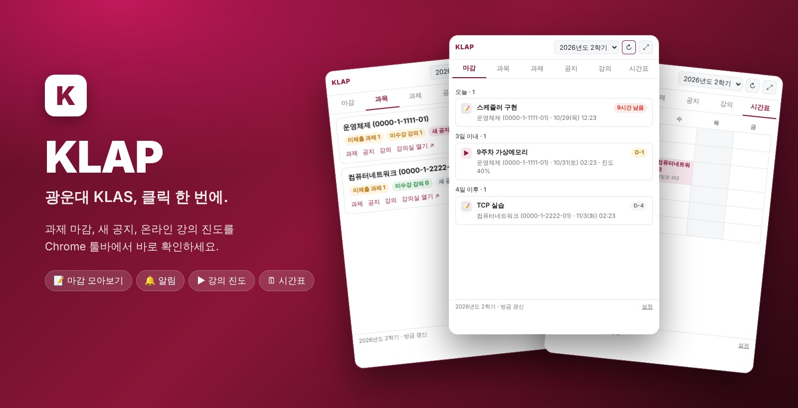
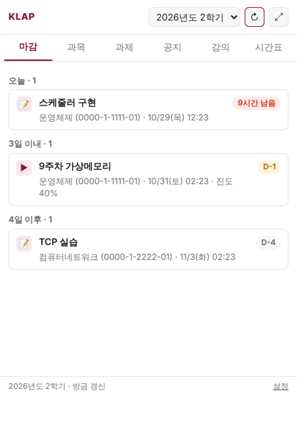
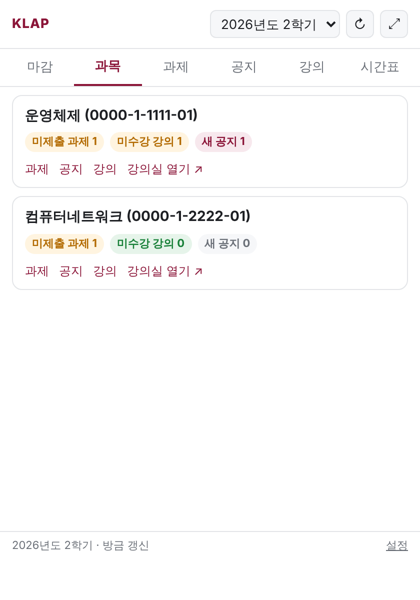
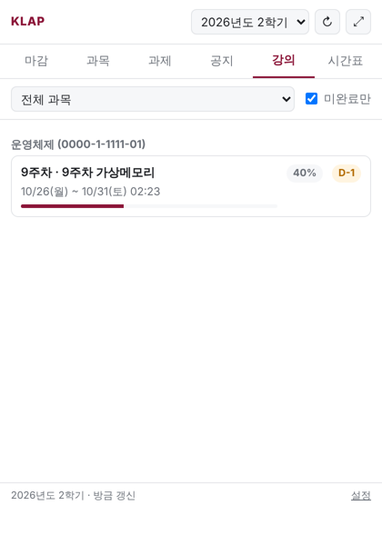
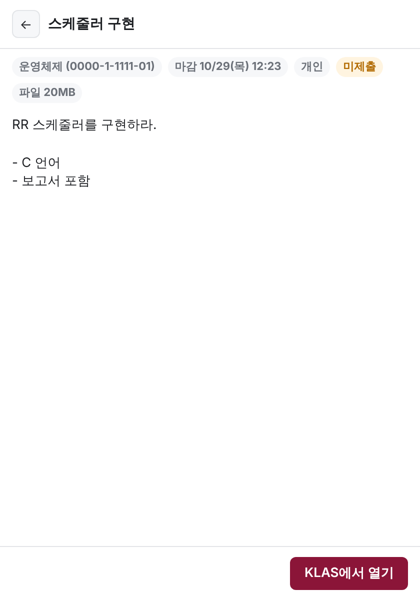
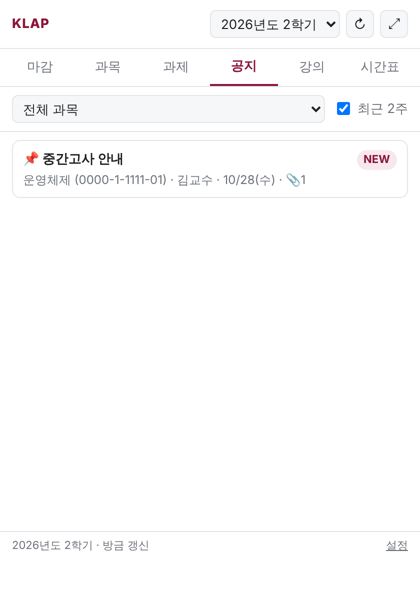
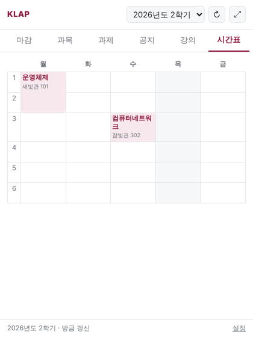
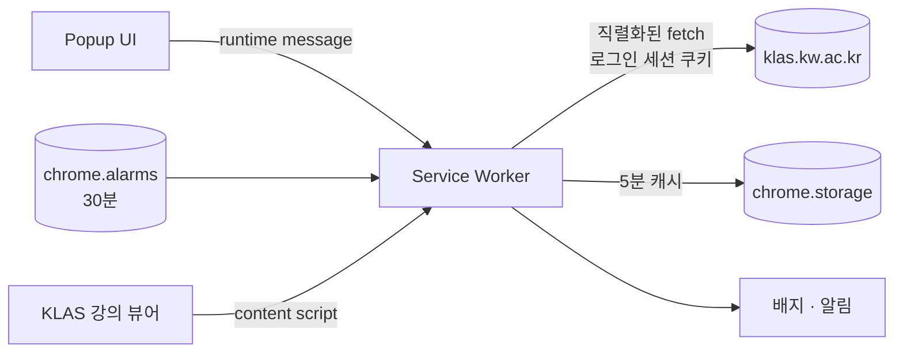

<div align="center">



# KLAP for Chrome

**광운대학교 KLAS의 과제, 공지, 온라인 강의를 Chrome 툴바 하나로.**

[](https://developer.chrome.com/docs/extensions/develop/migrate/what-is-mv3)
[](#-설치)
[](src/)
[](#-개발)
[](#-테스트)
[](LICENSE)

[기능](#-기능) · [설치](#-설치) · [동작 방식](#%EF%B8%8F-동작-방식) · [개발](#-개발) · [라이선스와 출처](#-라이선스와-출처)

</div>

---

## ✨ 왜 KLAP인가

KLAS에서 마감을 확인하려면 과목마다 강의실에 들어가 과제, 공지, 온라인 강의 메뉴를 하나씩 눌러야 합니다. KLAP은 이것을 **전 과목 한 화면**으로 모아 줍니다.

- 🔥 **마감이 먼저 보입니다.** 미제출 과제와 아직 안 들은 온라인 강의를 마감 순서대로 보여줍니다.
- 🔔 **놓치지 않습니다.** 새 공지가 올라오거나 마감이 24시간 남으면 Chrome 알림이 옵니다.
- 🔒 **비밀번호를 받지 않습니다.** 브라우저에 이미 로그인된 KLAS 세션만 사용합니다.
- ⚡ **빌드가 필요 없습니다.** 순수 JavaScript라서 폴더를 그대로 Chrome에 올리면 됩니다.

## 📸 미리보기

<div align="center">
<table>
  <tr>
    <td align="center"><br><sub><b>마감</b> · 오늘 / 3일 이내 / 4일 이후</sub></td>
    <td align="center"><br><sub><b>과목</b> · 과목별 현황 요약</sub></td>
    <td align="center"><br><sub><b>강의</b> · 온라인 강의 진도</sub></td>
  </tr>
  <tr>
    <td align="center"><br><sub><b>과제 상세</b> · 본문, 제출물, 피드백</sub></td>
    <td align="center"><br><sub><b>공지</b> · 전 과목 최신순</sub></td>
    <td align="center"><br><sub><b>시간표</b> · 클릭하면 강의실로</sub></td>
  </tr>
</table>
<sub>스크린샷은 E2E 테스트용 가상 데이터로 만들었습니다.</sub>
</div>

## 🧩 기능

| | 기능 | 설명 |
| :-: | --- | --- |
| 🔥 | **마감 모아보기** | 미제출 과제와 미수강 온라인 강의를 하나의 타임라인으로 정렬합니다. 표시 기간은 설정에서 바꿀 수 있습니다. |
| 📚 | **과목 대시보드** | 과목마다 미제출 과제, 미수강 강의, 새 공지 수를 보여주고 강의실로 바로 이동합니다. |
| 📝 | **과제** | 과목 필터와 미완료 필터를 지원합니다. 상세 화면에서 본문, 내 제출물, 점수, 교수 피드백을 확인합니다. |
| 📢 | **공지** | 전 과목 공지를 최신순으로 보여주고, 📌 고정 공지와 NEW 표시를 지원합니다. |
| ▶️ | **온라인 강의** | 주차, 수강 기간, 진도율을 진행 막대로 보여줍니다. |
| 🗓️ | **시간표** | 주간 시간표를 그리고 오늘 요일을 강조합니다. |
| 🔔 | **배지와 알림** | 30분마다 백그라운드에서 갱신합니다. 3일 이내 마감 개수를 아이콘 배지로, 새 공지와 마감 임박 항목을 알림으로 보냅니다. |
| 🤖 | **강의 뷰어 자동 진도** | KLAS 강의 뷰어에 진도를 60초마다 갱신하는 패널을 띄웁니다. |
| 🌗 | **다크 모드와 와이드 뷰** | 시스템 테마를 따라가고, ⤢ 버튼으로 새 탭에서 크게 볼 수 있습니다. |

## 🚀 설치

> Chrome 웹 스토어에는 아직 올리지 않았습니다. 개발자 모드로 설치합니다.

1. 이 레포를 clone하거나 Releases에서 zip을 받아 압축을 풉니다.
2. Chrome에서 `chrome://extensions`를 열고 오른쪽 위 **개발자 모드**를 켭니다.
3. **압축해제된 확장 프로그램을 로드합니다**를 누르고 `manifest.json`이 있는 폴더를 선택합니다.
4. [KLAS](https://klas.kw.ac.kr)에 로그인한 뒤 툴바의 **K** 아이콘을 누릅니다. 📌 고정해 두면 편합니다.

## ⚙️ 동작 방식



- **세션:** 브라우저의 KLAS 로그인 쿠키를 그대로 씁니다. 세션이 만료되면 팝업에 로그인 버튼이 나타납니다.
- **과목 컨텍스트:** KLAS는 “선택 과목”을 서버 세션에 저장합니다(`LctrumHomeStdInfo.do`). KLAP은 과목을 바꾸는 요청과 그 뒤의 조회를 하나의 lock으로 묶어 직렬화합니다. 이 때문에 열어 둔 KLAS 탭의 선택 과목이 바뀔 수 있으니, 이상하면 해당 탭을 새로고침하세요.
- **요청 헤더:** 확장 service worker가 보내는 요청(`tabIds: [-1]`)에만 `declarativeNetRequest`로 `Origin`/`Referer`를 KLAS로 맞춥니다. 일반 탭 탐색에는 영향이 없습니다.
- **범위:** 공지는 과목당 최근 3페이지까지 가져옵니다.

### 권한

| 권한 | 용도 |
| --- | --- |
| `host_permissions: klas.kw.ac.kr` | KLAS API 호출, 강의 뷰어 content script |
| `storage` | 5분 캐시, 설정, 알림 중복 방지 |
| `alarms` | 주기적 백그라운드 갱신 |
| `notifications` | 새 공지, 마감 임박 알림 |
| `declarativeNetRequestWithHostAccess` | 확장에서 보내는 KLAS 요청의 `Origin`/`Referer` 보정 |

## 🛠 개발

```text
manifest.json
src/
  klas.js        KLAS API client와 응답 정규화 (KLAP-cli internal/klas 포팅)
  views.js       마감 목록 계산 (klap due)
  background.js  service worker: 캐시, 직렬화, 알람, 배지, 알림, 헤더 규칙
popup/           팝업 UI (새 탭 와이드 뷰 겸용)
viewer/          강의 뷰어 자동 진도 content script (KLAP-cli에서 가져옴)
test/            unit test, fake KLAS 서버 기반 E2E
docs/images/     README 이미지
```

빌드 과정이 없습니다. 파일을 고친 뒤 `chrome://extensions`에서 ↻ 버튼만 누르면 반영됩니다.

## 🧪 테스트

```sh
npm test    # node:test: 응답 정규화, 과목 컨텍스트 직렬화, 마감 계산
```

E2E는 Playwright와 Chromium에 확장을 실제로 올리고, `klas.kw.ac.kr`을 로컬 HTTPS fake 서버로 매핑해서 돌립니다.

```sh
openssl req -x509 -newkey rsa:2048 -nodes -keyout key.pem -out cert.pem -days 2 \
  -subj /CN=klas.kw.ac.kr -addext subjectAltName=DNS:klas.kw.ac.kr
node test/e2e.mjs cert.pem key.pem out/
```

확인 항목은 로그인 만료 화면, 6개 탭, 과제·공지 상세, 배지 개수, `Origin` 보정, 일반 탭 헤더 미변경, “KLAS에서 열기” 전 과목 컨텍스트 설정입니다.

> [!WARNING]
> 응답 형태는 KLAP-cli의 sanitized fixture를 기준으로 합니다. KLAS 화면이나 API가 바뀌면 동작하지 않을 수 있습니다.

## 🗺 로드맵

- [ ] 성적, 석차 조회
- [ ] 출석 현황
- [ ] 강의계획서
- [ ] 학사일정을 마감 탭에 합치기
- [ ] Chrome 웹 스토어 배포

## 📄 라이선스와 출처

이 프로젝트는 [MIT License](LICENSE)로 배포합니다.

이 프로젝트는 **[leehyowon14/KLAP-cli](https://github.com/leehyowon14/KLAP-cli/tree/codex/shared-core)** 의 코드를 사용하고 변형했습니다. KLAP-cli는 MIT License(Copyright (c) 2026 KLAP contributors)로 배포되며, 원 저작권 고지와 라이선스 전문을 [LICENSE](LICENSE)에 함께 실었습니다.

- `src/klas.js`: KLAP-cli `internal/klas`, `internal/kwcommons`의 endpoint, payload, 응답 정규화를 Go에서 JavaScript로 옮겼습니다.
- `src/views.js`, `lectureNeedsAttendance`: `internal/app`의 마감, 수강 판정 규칙을 옮겼습니다.
- `viewer/*`: KLAP-cli `chrome-extension/`을 가져왔습니다(출처 주석만 추가).

파일별 출처는 [THIRD_PARTY_NOTICES.md](THIRD_PARTY_NOTICES.md)에 정리했습니다. 좋은 기반을 만들어 준 KLAP-cli 기여자들께 감사드립니다. 🙏

<div align="center"><sub>광운대학교의 공식 서비스가 아닙니다. KLAS는 광운대학교의 시스템입니다.</sub></div>
